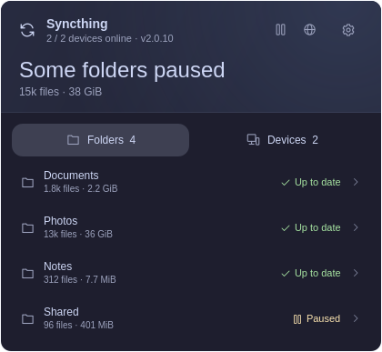

# Foamy Syncthing

Syncthing folder and device status in the Omarchy bar, with pause, unlink and
add-folder controls and a start/stop switch for the Syncthing user service.



## Install

Requires Omarchy 4.5 on **x86-64 or
ARM64 (aarch64) Linux**, systemd user services, Bash, `jq` and
`wl-clipboard`. Opening a
folder uses `uwsm-app` and `xdg-open`. **Choose an existing directory** opens
the desktop's folder chooser through xdg-desktop-portal (standard on Omarchy;
the helper asks it over the session bus).

**Syncthing itself is not bundled.** Install `syncthing` and enable its user
service, or use the popup's install button. That opens an Omarchy terminal
that runs `omarchy pkg add syncthing`, then
`systemctl --user enable --now syncthing.service`. It runs only when you
press it, one install at a time (a lock in `$XDG_RUNTIME_DIR`, which the
session must set). When Syncthing is missing but `~/.local/bin/syncthing` or
a user `syncthing.service` is still there, the popup says "Installation
needs cleanup" and names that file; Install stays off, so the plugin never
replaces or enables a unit of yours. Disable any other Syncthing shell plugin before enabling this one.

```sh
omarchy plugin add https://github.com/foamrider/foamy-syncthing.git --enable
```

The plugin bundles one helper binary, `bin/<arch>/foamy-syncthing-helper`
(x86_64 and aarch64), which talks to Syncthing, scans for conflict files and
asks the desktop's folder chooser for a directory (see [Native core](#native-core)). On other CPUs the popup says "This
plugin's helper isn't available for this CPU." and nothing retries.

## Use

- **Bar icon:** red when a folder has an error, is out of sync or has
  conflict files. Yellow when fewer devices than your warning threshold are
  connected. Dimmed while Syncthing is unreachable. Left-click opens the
  popup; right-click refreshes (and restarts a stopped core).
- **Popup:** the tinted header band shows how many devices are online, has
  start/stop (or install) and Web UI buttons, and holds the overall state with
  its progress ring. Below it are the **Folders** and **Devices** tabs. Expand a row for
  its path, errors, remaining items, progress and the devices or folders it
  is shared with. Folder rows have **Open folder**.
- Folder names are Syncthing's own folder labels (as in its Web UI), or the
  directory name when a folder has no label.
- An idle folder with outstanding items shows **Out of sync**. A folder with
  `*.sync-conflict-*` files shows **Conflicts**. Resolve both in the Web UI or
  a file manager. Device states describe local activity in shared folders,
  not a transfer to that device.
- **Settings** (cog or `s`):
  - **Shared folders**: **Pause** keeps a folder configured. **Unlink** asks
    first, then removes the folder from Syncthing and keeps its local files.
    **Add folder** shares an existing directory with the devices you pick,
    or accepts an incoming share.
  - The device warning and the refresh intervals.

Keyboard: arrows or `hjkl` move one cursor through the tabs, rows and header
buttons (hovering moves the same cursor). Enter activates: it expands a row
or selects a tab. `o` opens the folder under the cursor, `r` refreshes, `w`
opens the Web UI, `p` starts or stops syncing and `s` opens Settings. Esc
closes (or leaves Settings), and Tab or Shift+Tab moves to the next bar panel.
In Settings and Add folder, Tab walks the controls.

IPC (`omarchy-shell foamy.syncthing <fn>` or
`qs ipc call foamy.syncthing <fn>`): `open`, `close`, `toggle`, `show`,
`hide`, `settings`, `overview`. `qs ipc call foamy.syncthing.status state`
returns a JSON health summary.

## Settings

| Setting | Default | |
|---|---|---|
| `minimumConnectedDevices` | 0 (off) | Warn (yellow icon) when fewer devices are connected, this computer included |
| `refreshIntervalSec` | 60 | Full status refresh, 60–3600 s. File activity arrives live through Syncthing's event stream |
| `openRefreshIntervalSec` | 5 | Refresh while a popup is open, 2–60 s |
| `probeIntervalSec` | 15 | Installation check while Syncthing is offline (5–300 s); also the core's systemd probe interval |

All five are in Omarchy's widget settings (`barWidget.schema`); the popup's
Settings page has the device warning and both refresh intervals.
Settings save in place (`bar.shell.updateEntryInline`, else `omarchy bar set`).

## Resource use

- One native core per shell (the plugin's service), however many monitors
  show the bar. It long-polls Syncthing's event stream once a second over
  keep-alive loopback connections. Idle for 10 minutes against a local
  Syncthing 2.1.7 it used 0.2 s CPU and 2.2 MB RSS (2.9 MB with TLS); the
  Go core it replaced used 0.5 to 0.6 s and 14.5 to 17.4 MB.
- The installation check (`scripts/syncthing-install.sh status`) runs only
  while Syncthing is unreachable.
- The conflict scan walks the configured folders when the folder set
  changes, when Syncthing comes back online, and every 5 minutes, not on
  every sync event. It skips Syncthing's `.stversions` and `.stfolder`
  directories. It follows configured root links but never links inside the
  roots, and counts only regular files named `*.sync-conflict-*`. It gets
  the paths on stdin (never in arguments) and is bounded (1 MiB input,
  30-second hard deadline, 25 s in the helper itself). It runs the
  helper's `conflicts` subcommand, which starts no other programs. A failed
  scan keeps the last result and shows an error.
- The popup content is built on first open. Its rows update in place and
  are computed only while it is open.
- A core that crashes is restarted after 250 ms, 500 ms and 1 s, then every
  30 s, doubling up to 5 minutes. Opening the popup or right-clicking starts
  it at once.

## Native core

`bin/x86_64/foamy-syncthing-helper` and `bin/aarch64/foamy-syncthing-helper`
are one static Rust program with three subcommands:

- `stream` is the native core: a Rust port of the native core of
  [Syncshell](https://github.com/omarchy-QOL/syncshell) (MIT, by IlyaZar; see
  `LICENSE-SYNCSHELL`), following `core/` at commit
  `7318f1404e765f274df3d079e35d0ad32b5c1701` (v0.1.9), which this plugin
  bundled as a Go binary before. It speaks the same JSON-lines protocol (v2)
  over stdin/stdout, and for the same Syncthing replies it writes the same
  bytes. It reads Syncthing's API key from Syncthing's own `config.xml` and
  keeps it to itself: the key never reaches QML, process arguments, the
  environment, logs, snapshots or errors, and it is sent only to the
  selected Syncthing (never on the unauthenticated health check, never
  across a redirect to another address). It runs the REST and event-stream
  calls (loopback or a `unix://` GUI socket, with the GUI certificate
  `https-cert.pem` pinned when TLS is on), the folder actions, and `systemctl --user start|stop` for
  `syncthing.service` only.
- `conflicts` is the conflict scan (see [Resource use](#resource-use)).
- `pick-folder` opens the folder chooser for **Choose an existing directory**:
  one `org.freedesktop.portal.FileChooser` request on the session bus (no
  other programs, no files), answered with the chosen path, a cancel or an
  error code; it waits for you for up to 30 minutes.

Only what the panel uses is ported: the snapshot, `refresh`, `configure`,
`shutdown`, and the actions pause, resume, unlink (forget), add an existing
directory, suggest a folder ID, recheck folder errors, and start or stop
the service. Syncshell's desktop bridge (`--desktop-authorized`), its
`probe`/`status` commands, Web UI theme and import tools, rescans, sharing
and device controls are not part of this core. The contract is written at
the top of `native/src/main.rs`.

The binaries are built reproducibly with the plugin's
`kit/native/build-native.sh` (the Rust toolchain in `rust-toolchain.toml`, static
musl, the kit's release profile); `native/native.pin` records the toolchain,
the source hash and each binary's sha256, and `bash tests/kit-check.sh`
checks them (see [Verifying the helper binaries](#verifying-the-helper-binaries)). HTTPS uses
rustls with Graviola's cryptography (Rust and assembly, so both
architectures build without a C cross-compiler). HTTPS needs AES, carry-less
multiply, AVX2, BMI2 and ADX on x86-64 (Intel Broadwell, AMD Zen or newer),
or the crypto extensions on ARMv8 (a Raspberry Pi 5, not a Pi 4); without
them plain HTTP still works, and with an HTTPS GUI the panel says HTTPS isn't
supported on this CPU (in English, like the core's other connection errors).
Third-party licenses: `LICENSE-NATIVE-DEPENDENCIES`.

This port is ours to maintain: Syncshell's later releases are not picked
up automatically (DEVELOPMENT.md explains how to carry a fix over).

The plugin starts the core without `--desktop-authorized` (the desktop
bridge was never used); the Web UI opens in your browser.

## Privacy and safety

- Folder actions never delete or rename files. Unlink pauses the folder,
  then removes it from Syncthing's configuration. Add folder accepts existing
  directories only.
- Results stay in the popup; the plugin sends no desktop notifications.
- Text fields paste through a bounded helper outside the shell (at most
  16 KiB, two-second deadline, line breaks become spaces). Oversized or
  stalled clipboard sources leave the field unchanged and show an error.

## Validate

```sh
mise install                          # once: the tool versions mise.toml pins
tests/validate.sh                     # every check below, the linters and the native tests
tests/validate.sh --ci                # what CI runs: no Quickshell, no Omarchy host
```

`tests/validate.sh` runs the linters and formatters (findings that existed
at adoption are in `tests/lint/`), `kit/native/build-native.sh . --test`
and then `tests/suite.sh`, which runs the tests one by one:

```sh
node --test tests/*.test.js tests/*.test.cjs
python3 -I -m unittest discover -s tests -p 'test_*.py'
FOAMY_HELPER='["bin/aarch64/foamy-syncthing-helper"]' \
  python3 -I -m unittest discover -s tests -p 'test_*.py'   # the aarch64 build (qemu binfmt)
python3 tests/runtime.py              # offscreen on 4.5 (needs foamy-kit)
python3 "$FOAMY_KIT"/preview/i18n_runtime.py .   # live language switch (the kit's catalog check)
bash tests/kit-check.sh               # kit files and the native pin
"$FOAMY_KIT"/check.sh .               # the kit's design lint (FOAMY_KIT: a foamy-kit checkout)
omarchy-plugin-validate .
```

The offscreen tests run on Omarchy 4.5, the installed `/usr/share/omarchy/shell`
(`FOAMY_HOST_45` picks another 4.5 tree).

The tests need Python 3 (development only). `tests/test_stream.py` runs the
real core against a fake Syncthing (`tests/fake_syncthing.py`) and a fake
`systemctl` on a `PATH` that holds nothing else; `FOAMY_HELPER` (a JSON argv
prefix) selects another build, e.g.
`FOAMY_HELPER='["bin/aarch64/foamy-syncthing-helper"]'` through qemu
binfmt. The runtime test uses `tests/fake-core.py` in place of the core.
None of them touches your Syncthing, its service or your shell
configuration.

## Verifying the helper binaries

`bin/x86_64/foamy-syncthing-helper` and `bin/aarch64/foamy-syncthing-helper` are compiled from the Rust source in this repository: `native/`, the
shared crate in `kit/rust/`, the dependencies locked in `Cargo.lock` and the
toolchain pinned in `rust-toolchain.toml`, with the build tool in
`kit/native/`. The build is reproducible. `native/native.pin` records the
toolchain, a hash of every build input (`source`) and the SHA-256 of each
binary.

**CI.** The [Verify native helpers](https://github.com/foamrider/foamy-syncthing/actions/workflows/verify-native.yml)
workflow rebuilds both binaries on a GitHub-hosted runner for every push,
compares them byte for byte with `bin/`, and attests the rebuilt files. To
check the committed files against that attestation (GitHub CLI):

```sh
gh attestation verify bin/x86_64/foamy-syncthing-helper --repo foamrider/foamy-syncthing \
  --signer-workflow foamrider/foamy-syncthing/.github/workflows/verify-native.yml \
  --deny-self-hosted-runners
gh attestation verify bin/aarch64/foamy-syncthing-helper --repo foamrider/foamy-syncthing \
  --signer-workflow foamrider/foamy-syncthing/.github/workflows/verify-native.yml \
  --deny-self-hosted-runners
```

Add `--source-digest <commit>` to require a particular commit.

**Yourself.** You need `rustup`, Python 3.11 or newer and `file`. From a
checkout of this repository at the commit you want to check:

```sh
rustup toolchain install "$(awk '$1 == "toolchain" { print $2 }' native/native.pin)" \
  --profile minimal --target x86_64-unknown-linux-musl,aarch64-unknown-linux-musl
kit/native/build-native.sh . --verify
```

It builds both binaries from scratch in `~/.cache/foamy-native/` (nothing is
written to the checkout), compares them byte for byte with `bin/`, checks
that the kit files are unmodified and that `native.pin` matches the source,
and ends with `verify OK (foamy-syncthing-helper, <toolchain>, both arches reproducible)`.

### Building the helper yourself

To run binaries you built instead of the committed ones, build them in the
installed plugin with the same toolchain, then run `omarchy restart shell`:

```sh
cd ~/.config/omarchy/plugins/foamy.syncthing
kit/native/build-native.sh .
```

The build is reproducible, so `git status` shows no change when your
binaries match the release, and `omarchy plugin update` still applies.

## Remove

```sh
omarchy plugin remove foamy.syncthing
```

This removes the plugin and stops its native core. It does not uninstall
Syncthing, stop its user service, delete synchronized files or undo folder
changes made in Syncthing. To stop synchronization as well, stop the
Syncthing user service first.

## Language

Language follows **Omarchy → Setup → Language** on Omarchy 4.5 (English and
Norwegian Bokmål; missing strings fall back to English).

## License

`kit/` holds shared components copied from [foamy-kit](https://github.com/foamrider/foamy-kit); edit them there, not here.

Plugin code is [MIT](LICENSE). The native core is a port of Syncshell's
([MIT](LICENSE-SYNCSHELL), © IlyaZar). The helper binaries also contain the
Rust standard library, musl and the crates listed in
[LICENSE-NATIVE-DEPENDENCIES](LICENSE-NATIVE-DEPENDENCIES) (MIT, MIT-0, ISC
and BSD-3-Clause). Shared components in
`kit/` come from [foamy-kit](https://github.com/foamrider/foamy-kit) (MIT;
Lucide icons ISC, `kit/LICENSE-LUCIDE`; parts adapted from Omarchy, MIT,
`kit/LICENSE-OMARCHY` and `LICENSE-OMARCHY`).

Provided **as is**, without warranty or guaranteed support. Use at your own risk.
