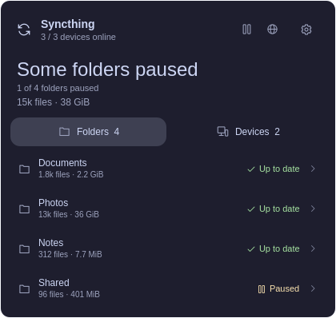

# Foamy Syncthing

Syncthing folder and device status in the Omarchy bar, with pause, unlink and
add-folder controls and a start/stop switch for the Syncthing user service.



## Install

Requires Omarchy 4.5 (it also loads on 4.0.6, in English) on **x86-64 Linux**,
systemd user services, Bash, `jq`, Python 3 and `wl-clipboard`. Opening a
folder uses `uwsm-app` and `xdg-open`. **Choose an existing directory** uses
`qml6` and `hyprctl`.

**Syncthing itself is not bundled.** Install `syncthing` and enable its user
service, or use the popup's install button. That opens an Omarchy terminal
that runs `omarchy pkg add syncthing`, then
`systemctl --user enable --now syncthing.service`. It runs only when you
press it. Disable any other Syncthing shell plugin before enabling this one.

```sh
omarchy plugin add https://github.com/foamrider/foamy-syncthing.git --enable
```

The plugin bundles one helper binary, `bin/x86_64/syncshell-core`, which talks
to Syncthing (see [Native core](#native-core)). Other CPU architectures are
not supported.

## Use

- **Bar icon:** red when a folder has an error, is out of sync or has
  conflict files. Yellow when fewer devices than your warning threshold are
  connected. Dimmed while Syncthing is unreachable. Left-click opens the
  popup; right-click refreshes (and restarts a stopped core).
- **Popup:** the tinted header band shows how many devices are online, has
  start/stop (or install) and Web UI buttons, and holds the overall state with
  its progress ring. Below it are the **Folders** and **Devices** tabs. Expand a row for
  its path, errors, remaining items, progress and the devices or folders it
  is shared with. Folder rows have **Open folder**.
- Folder names are Syncthing's own folder labels (as in its Web UI), or the
  directory name when a folder has no label.
- An idle folder with outstanding items shows **Out of sync**. A folder with
  `*.sync-conflict-*` files shows **Conflicts**. Resolve both in the Web UI or
  a file manager. Device states describe local activity in shared folders,
  not a transfer to that device.
- **Settings** (cog or `s`):
  - **Shared folders**: **Pause** keeps a folder configured. **Unlink** asks
    first, then removes the folder from Syncthing and keeps its local files.
    **Add folder** shares an existing directory with the devices you pick,
    or accepts an incoming share.
  - The device warning and the refresh intervals.

Keyboard: arrows or `hjkl` move one cursor through the tabs, rows and header
buttons (hovering moves the same cursor). Enter activates: it expands a row
or selects a tab. `o` opens the folder under the cursor, `r` refreshes, `w`
opens the Web UI, `p` starts or stops syncing and `s` opens Settings. Esc
closes (or leaves Settings), and Tab or Shift+Tab moves to the next bar panel.
In Settings and Add folder, Tab walks the controls.

IPC (4.5: `omarchy-shell foamy.syncthing <fn>`, both versions:
`qs ipc call foamy.syncthing <fn>`): `open`, `close`, `toggle`, `show`,
`hide`, `settings`, `overview`. `qs ipc call foamy.syncthing.status state`
returns a JSON health summary.

## Settings

| Setting | Default | |
|---|---|---|
| `minimumConnectedDevices` | 0 (off) | Warn (yellow icon) when fewer devices are connected, this computer included |
| `refreshIntervalSec` | 60 | Full status refresh, 60–3600 s. File activity arrives live through Syncthing's event stream |
| `openRefreshIntervalSec` | 5 | Refresh while a popup is open, 2–60 s |
| `probeIntervalSec` | 15 | Installation check while Syncthing is offline (5–300 s); also the core's systemd probe interval |
| `serviceState` | `enabled` | Passed to the native core as the intended autostart state; the panel doesn't act on it |

The first four are in Omarchy's widget settings (`barWidget.schema`); the
popup's Settings page has the device warning and both refresh intervals.
Settings save in place (`bar.shell.updateEntryInline`, else `omarchy bar set`).

## Resource use

- One native core per shell (the plugin's service), however many monitors
  show the bar. Over one keep-alive loopback connection to Syncthing it used
  under 1 s CPU in 27 minutes, and 17.6 MB RSS.
- The installation check (`scripts/syncthing-install.sh status`) runs only
  while Syncthing is unreachable.
- The conflict scan walks the configured folders when the folder set
  changes, when Syncthing comes back online, and every 5 minutes, not on
  every sync event. It skips Syncthing's `.stversions` and `.stfolder`
  directories. It follows configured root links but never links inside the
  roots, and counts only regular files named `*.sync-conflict-*`. It gets
  the paths on stdin (never in arguments) and is bounded (1 MiB input,
  30-second hard deadline). A failed scan keeps the last result and shows an
  error.
- The popup content is built on first open. Its rows update in place and
  are computed only while it is open.
- A core that crashes is restarted after 250 ms, 500 ms and 1 s, then every
  30 s, doubling up to 5 minutes. Opening the popup or right-clicking starts
  it at once.

## Native core

`bin/x86_64/syncshell-core` is the unmodified native core of
[Syncshell](https://github.com/omarchy-QOL/syncshell) 0.1.9 (MIT, by IlyaZar;
see `LICENSE-SYNCSHELL`). It is third-party code. It reads Syncthing's API
key from Syncthing's own `config.xml` and keeps it to itself: the key never
reaches QML, process arguments, logs or the panel. It also runs the REST and
event-stream calls (loopback, with the GUI certificate when TLS is on), the
folder actions, and `systemctl --user` start/stop for `syncthing.service`.
The panel talks to it as JSON lines over stdin/stdout.

Provenance (`packaging/bundled/core.pin`):

| | |
|---|---|
| Upstream | https://github.com/omarchy-QOL/syncshell, tag `v0.1.9`, commit `7318f1404e765f274df3d079e35d0ad32b5c1701` |
| Binary | byte-identical to `bin/x86_64/syncshell-core` at that commit; sha256 `b527c64a566cf75b3eced6d99b026b61ed3bdae2b7aa45340f7b78c259479bdf` (`packaging/bundled/SHA256SUMS`) |
| Go | `go1.27.1` (from the binary's build info) |
| Flags | `CGO_ENABLED=0 GOOS=linux GOARCH=amd64 go build -mod=readonly -trimpath -buildvcs=false -ldflags=-buildid= ./cmd/syncshell-core` in `core/` (upstream `packaging/bundled/build.sh`) |
| Dependencies | `golang.org/x/sys v0.31.0` only (hash pinned by upstream `core/go.sum`) |

- `packaging/bundled/verify-core.sh` checks the checksum, that the binary is
  a static x86-64 ELF, and the Go build metadata above.
- `packaging/bundled/build-core.sh` fetches the pinned commit, rebuilds with
  those flags and the pinned Go release (through `GOTOOLCHAIN`, which may
  download it from the Go proxy), and compares the result with the bundled
  binary.

What was verified for this release: the checksum and build metadata match,
and the bundled file is the one in the upstream tag. A rebuild of that
commit with go1.27.3 (go1.27.1 couldn't be fetched in the review
environment) has the same module graph and the same 217 Syncshell symbols
with the same sizes. Its bytes differ, as expected from a different
toolchain. A byte-for-byte rebuild with go1.27.1 hasn't been run yet.
`build-core.sh` does exactly that.

The plugin starts the core without `--desktop-authorized`, so the core's
local HTTP "desktop bridge" (file open/rename for the Syncshell Web UI) is
off. The Web UI opens in your browser.

## Privacy and safety

- Folder actions never delete or rename files. Unlink pauses the folder,
  then removes it from Syncthing's configuration. Add folder accepts existing
  directories only.
- Results stay in the popup; the plugin sends no desktop notifications.
- Text fields paste through a bounded helper outside the shell (at most
  16 KiB, two-second deadline, line breaks become spaces). Oversized or
  stalled clipboard sources leave the field unchanged and show an error.

## Validate

```sh
node --test tests/*.test.js tests/*.test.cjs
python3 -I -m unittest discover -s tests -p 'test_*.py'
python3 tests/runtime.py              # offscreen, 4.0 and 4.5 (needs foamy-kit)
python3 tests/i18n-runtime.py         # OMARCHY_PATH=<4.5 tree> for the 4.5 language switch
bash tests/kit-check.sh
packaging/bundled/verify-core.sh
omarchy-plugin-validate .
```

The runtime test uses `tests/fake-core.py` in place of the native core. It
never touches Syncthing, its service or your shell configuration.

## Remove

```sh
omarchy plugin remove foamy.syncthing
```

This removes the plugin and stops its native core. It does not uninstall
Syncthing, stop its user service, delete synchronized files or undo folder
changes made in Syncthing. To stop synchronization as well, stop the
Syncthing user service first.

## Language

Language follows **Omarchy → Setup → Language** on Omarchy 4.5 (English and
Norwegian Bokmål; missing strings fall back to English). Omarchy 4.0 shows
the plugin in English.

## License

`kit/` holds shared components copied from [foamy-kit](https://github.com/foamrider/foamy-kit); edit them there, not here.

Plugin code is [MIT](LICENSE). The native core is Syncshell's
([MIT](LICENSE-SYNCSHELL)) and contains the Go runtime and `golang.org/x/sys`
([BSD-3-Clause](packaging/bundled/LICENSE.golang)). Shared components in
`kit/` come from [foamy-kit](https://github.com/foamrider/foamy-kit) (MIT;
Lucide icons ISC, `kit/LICENSE-LUCIDE`; parts adapted from Omarchy, MIT,
`kit/LICENSE-OMARCHY` and `LICENSE-OMARCHY`).

Provided **as is**, without warranty or guaranteed support. Use at your own risk.
